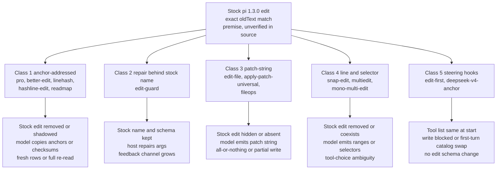

# Synthesis Report — How pi Edit-Tool Plugins Change the File-Edit Contract

Sources: three explorer reports (fbdc9692, 795c9d09, 0d6632f1) plus on-disk extracts at `/tmp/spike/`. Web fetch was unavailable in this session. All package claims come from pi.dev page snapshots. A claim marked "vendor claim" comes from a package README and was not verified against source.

---

## 1. Overview

The pi ecosystem is a package registry at `https://pi.dev/packages/<name>` that delivers npm packages as pi-coding-agent extensions. pi reads a `packages` array from the agent-dir `settings.json`, installs each package under `<agent-dir>/npm/node_modules/`, and runs the entry file declared in the package manifest (evidence: `/tmp/spike/cfg-editguard/settings.json`, `/tmp/spike/cfg-editguard/npm/package.json`, `/tmp/spike/full-pi-edit-guard.txt:46-60`). Three explorers inspected 14 edit-related packages and confirmed 5 name-based false hits (`/tmp/spike/candidates.json`).

The 14 real packages change the file-edit contract in five ways. Some remove stock `edit` and teach the model anchors or checksums. Some keep the stock `edit` name and repair the model on the host. Some hide stock `edit` and teach a patch string. Some add line and selector tools beside or instead of stock `edit`. Two only steer calls and change no edit schema at all. The cost to a weak model ranges from zero new vocabulary (repair class) to a full eight-tool surface (pro).

## 2. Key Concepts

Five mechanism classes appear in the evidence:

1. **Anchor-addressed replacement.** The model copies a short code instead of old text. The code comes from an allocator (pro), a content hash (better-edit, hashline-edit, readmap), or a whole-file checksum plus line numbers (linehash).
2. **Repair behind the stock name.** The tool name and schema stay stock. Host code repairs arguments and widens the match ladder. Only the feedback text grows (edit-guard).
3. **Patch-string tools.** The model emits a hunk block with a header line. The host parses, matches, and writes (edit-file, apply-patch-universal, fileops, and mono-multi-edit's `apply_patch`).
4. **Line and selector tools.** The model emits line ranges or a selector per item: `old`, `from`+`to`, `regex`, `json` (snap-edit, multiedit, mono-multi-edit's `multi_file_edit`).
5. **Steering hooks.** No edit schema changes. A `tool_call` hook blocks `write`, or the first request shows a smaller tool catalog (edit-first, deepseek-v4-anchor).

Vocabulary the reports share:

- **Serve.** A read, grep, or diff output that grants anchors. An anchor exists only after a serve (`/tmp/spike/pi-hashline-edit-pro.txt`, How anchors work).
- **Staleness.** The host refuses an edit when the served record no longer matches. Codes: `E_STALE_ANCHOR`, `E_STALE_CHECKSUM`, `E_RANGE_STALE`.
- **Fresh-rows recovery.** The refusal text carries new anchor rows, so the next edit needs no re-read (pro, better-edit). Linehash instead demands a full re-read.
- **Partial apply.** The host writes a subset of a multi-item edit. edit-guard and fileops do this by design. edit-file, snap-edit, and apply-patch-universal do not (`/tmp/spike/full-pi-edit-guard.txt:271-272`, `/tmp/spike/cand/pi-fileops.html`).
- **Echo refusal.** The host blocks text that reproduces served rows. pro: `E_WRITE_HASH_ECHO`. Linehash rejects a pasted display row.
- **Killswitch.** A config key or env var that restores stock tools, for example `editOverrideEnabled`, `PI_ANCHORED=0`, `PI_HASHLINE_DIR`.

"Anchor" carries five different meanings across packages. The word does not transfer between them (explorer fbdc9692, Non-Obvious Things 3).

## 3. How It Works

### Class 1 — Anchor-addressed replacement

- **Model emits.** A 4-char anchor pair (pro, better-edit), a `LINE#HASH` token (hashline-edit), a `LINE:HASH` key (readmap), or a 22-char file checksum plus line ranges (linehash). Stock `oldText` is gone.
- **Host runs.** It validates the anchor against a served record or a file version, applies bottom-up, and returns a diff. pro and better-edit return fresh rows inside every staleness error. linehash returns the next checksum and auto-read windows (vendor claims: `/tmp/spike/pi-hashline-edit-pro.txt:101`, `/tmp/spike/full-pi-linehash-edit.txt:211`).
- **Disk.** pro and better-edit keep SQLite stores under `~/.config/<pkg>/`. linehash keeps only `~/.config/pi-linehash-edit/config.json` and calls the protocol stateless (`/tmp/spike/full-pi-linehash-edit.txt:254`). hashline-edit keeps `~/.pi/agent/hashline.json`; its snapshot location is undocumented. readmap keeps settings files plus a mapper cache.
- **Next edit.** Fresh anchors from the diff, or a re-read when the error says so. Batch rules apply: ranges must be disjoint, and one bad member aborts the batch.

### Class 2 — Repair behind the stock name (edit-guard)

- **Model emits.** Stock `edit` arguments. No schema change. One new tool `undo` joins the catalog (`/tmp/spike/full-pi-edit-guard.txt:156-162`).
- **Host runs.** Envelope recovery, field aliases, schema-guided repair up to 3 passes, then a 14-pass tiered match chain over the file, then an atomic rename write. The result adds a `guard` block and `<repair_note>` text (vendor claim, same file, "Result shaping").
- **Disk.** An append-only undo JSONL. Real run data confirms the format at `/tmp/spike/cfg-editguard/pi-better-toolcalls-undo-store.jsonl`.
- **Next edit.** Stock rules hold. New refusal paths appear: stale-read block, stormbreaker abort after 3 identical failures, and partial-apply reports.

### Class 3 — Patch-string tools

- **Model emits.** `{path, patch}` flat string (edit-file), a Codex `*** Begin Patch` block (apply-patch-universal, fileops, mono-multi-edit). Hunk headers carry `@@` line hints.
- **Host runs.** A tiered match ladder per hunk. edit-file and apply-patch-universal compute all hunks before any write. fileops runs a native Rust binary that reports a `fuzz` value. Grammar-constrained sampling exists on two packages (vendor claims: `/tmp/spike/cand/pi-apply-patch-universal.html`, `/tmp/spike/cand/pi-fileops.html`).
- **Disk.** No undo store documented for any of the four. apply-patch-universal rolls back only inside one call. fileops builds or loads a Rust binary via `PI_APPLY_PATCH_BIN`.
- **Next edit.** The model re-reads failed files. fileops returns `partial_failure` with a committed prefix and marks the result an error.

### Class 4 — Line and selector tools

- **Model emits.** `quick_edit` with `expectedStartLine`, or `target_edit` ops (snap-edit). An `edits` array with one selector per item (multiedit). Cross-file replacements or `apply_patch` beside stock tools (mono-multi-edit).
- **Host runs.** Match tiers: exact substring, then unescaped, then whole-line trim. Fuzzy hints are diagnostic only. multiedit checks everything in memory and writes atomically (vendor claim: `/tmp/spike/cand/pi-multiedit.html`).
- **Disk.** multiedit writes temp file plus rename and loses hard links, owner, and extended attributes (vendor claim). mono-multi-edit offers best-effort rollback only. snap-edit documents no disk state and carries a "superseded by pi-utils" banner (`/tmp/spike/cand/pi-snap-edit.html:33`).
- **Next edit.** Refreshed context with line numbers. mono-multi-edit leaves stock `edit` in place, so the model must choose among 4 edit-capable tools.

### Class 5 — Steering hooks

- **Model emits.** Unchanged edit calls. edit-first may see a one-line block reason. deepseek-v4-anchor sees only `bash` and `str_replace_editor` on the first request with a 1024-token output cap (vendor claim: `/tmp/spike/cand/pi-deepseek-v4-anchor.html`).
- **Host runs.** A `tool_call` hook that fails open, or a per-model-id request rewrite. No file-edit logic.
- **Disk.** edit-first touches no files. deepseek-v4-anchor writes `~/.pi/agent/settings.json` and logs under `~/.pi/agent/tmp/`.
- **Next edit.** edit-first steers to stock `edit`, the tool the weak model already fails at. deepseek-v4-anchor restores the full catalog after the first durable tool call.

## 4. Where Things Live

**Registry.** `https://pi.dev/packages/<name>` shows version, publish date, downloads, license, size, deps, a "Pi manifest JSON" block, and the README. Snapshots on disk: `/tmp/spike/pi-*.txt`, `/tmp/spike/full-pi-*.txt`, `/tmp/spike/cand/*.html`. Search dumps: `/tmp/spike/npmsearch.json`, `/tmp/spike/all-packages.txt`, `/tmp/spike/candidates.json`.

**npm delivery.** Install form is `pi install npm:<name>` or `pi install git:github.com/<owner>/<repo>` (`/tmp/spike/full-pi-edit-guard.txt`, install section). pi writes `<agent-dir>/npm/package.json` with name `pi-extensions` and installs to `npm/node_modules/<name>/` (evidence: `/tmp/spike/cfg-editguard/npm/`). The manifest declares the entry, for example `{"extensions": ["./dist/index.js"]}` (`/tmp/spike/full-pi-edit-guard.txt:56-60`).

**Config load path in a pi install.** The agent directory holds `settings.json` with a `packages` array (evidence: `/tmp/spike/cfg-editguard/settings.json`, `/tmp/spike/cfg-hashlinepro/settings.json`). The default agent dir is `~/.pi/agent`. Extensions load at session start. readmap states that sessions do not hot-reload extensions (`/tmp/spike/cand/pi-hashline-readmap.html:43`). Per-package config sits in two different places: `~/.pi/agent/<pkg>.json` for some packages, `~/.config/<pkg>/` for others, with env overrides listed in Gotchas.

**Disk state per class.**

| Class | Disk state |
|---|---|
| Anchor, stateful | `~/.config/pi-hashline-edit-pro/hash-store.sqlite` + `-wal`/`-shm`, `sessions/<key>.registry.jsonl`, `config.json`. `~/.config/pi-better-edit/hash-store.sqlite` with tables `file_snapshots`, `line_lineage`, `served_leases`, `file_undo` (vendor claims) |
| Anchor, stateless | `~/.config/pi-linehash-edit/config.json` only |
| Anchor, partial | `~/.pi/agent/hashline.json` (hashline-edit), `~/.pi/agent/hashline-readmap/settings.json` plus project `.pi/hashline-readmap/` |
| Repair behind stock name | Undo JSONL: `PI_UNDO_STORE_PATH`, else `<agent-dir>/pi-better-toolcalls-undo-store.jsonl`, else `~/.local/state/pi-better-toolcalls/undo-store.jsonl`; config `edit-guard-config.json` in agent dir or project `.pi/` |
| Patch-string | No undo store documented. `~/.pi/agent/pi-apply-patch.json` for apply-patch-universal. Rust binary for fileops |
| Line and selector | Temp file plus rename (multiedit). No documented state (snap-edit, mono-multi-edit) |
| Steering | No files (edit-first). `~/.pi/agent/settings.json` plus logs (deepseek-v4-anchor) |

## 5. Tradeoffs Table

| Package | Mechanism class | Stock tool contract changed | What a weak model must learn | Disk state and requirements | Maintenance signal | Evidence strength |
|---|---|---|---|---|---|---|
| pi-hashline-edit-pro v6.5.1 | Anchor-addressed | Yes. Replaces `read`, `grep`; disables `edit`; adds `replace`, `insert`, `replace_match`, `copy`, `move`, `undo_last_change` (`/tmp/spike/pi-hashline-edit-pro.txt:268`) | 8 tools, flat anchor schemas, batch rules, echo refusal, live vs dead rows | SQLite store, `~/.config/pi-hashline-edit-pro/`. pi >= 0.99.0, Node 22.19+ or Bun with `bun:sqlite`. Fails `E_STORE_UNAVAILABLE` without it | v6.5.1, Oct 20 2026, 18.9K/mo, MIT, 15.7 MB (`pi-hashline-edit-pro.txt:40-70`) | README + harness (insert-after fail, big-file and escaped-json pass: `/tmp/spike/matrix.log:22`, `/tmp/spike/hard.log`) + installed source on disk |
| pi-better-edit v2.13.3 | Anchor-addressed | Yes, inferred. Registers `read`, `edit`, `undo_last_edit` under stock names. No explicit "disabled" sentence in README | `file` key not `path`, XOR payload, exact `"in-place"` spelling, 1-32 batch, serve discipline | SQLite store `~/.config/pi-better-edit/`. Node >= 24.0.0, pi >= 0.75.0 (`/tmp/spike/pi-better-edit.txt:211-214`) — fails operator Node v22.19.0 as written | v2.13.3, Oct 22 2026, 3,788/mo, MIT, 1.6 MB (`pi-better-edit.txt:78`) | README + harness (7/7 pass). Node floor untested at runtime |
| pi-linehash-edit v2.3.4 | Anchor-addressed | Yes. Replaces `read`, registers `replace`, disables `edit` (`/tmp/spike/full-pi-linehash-edit.txt:311-315`) | 22-char checksum, inclusive line ranges, full `content_lines`, count accuracy | Stateless. Config only. pi >= 0.79.0, no database | v2.3.4, Oct 1 2026, 296/mo, MIT, 60.5 KB (`/tmp/spike/candidates.json`) | README + harness. indent-mismatch flaky: 1 pass, 2 fail, 1 timeout over 4 runs (`/tmp/spike/harness/out2-rep*/results.tsv`, `/tmp/spike/matrix.log`) |
| pi-hashline-edit v0.8.3 (upstream) | Anchor-addressed | Yes. Replaces `read` and `edit` | `LINE#HASH` tokens, full `lines` arrays, neighbor rotation of anchors | Config `~/.pi/agent/hashline.json`. Snapshot location undocumented. No version floors documented | v0.8.3, Jul 14 2026, 932/mo, MIT, 185.4 KB. Oldest publish of the five | README only. Not in harness |
| pi-hashline-readmap v0.16.1 | Anchor-addressed | Yes. Replaces `read`, `edit`, `grep`, `write`, `ls`, `find`; adds `ast_search`; post-processes `bash` (`/tmp/spike/cand/pi-hashline-readmap.html:34`) | 6 replaced tools, 5 edit verbs, `LINE:HASH` anchors. Per-verb schemas not fetched | Settings files plus mapper cache. Node 22.19+. Validated at Pi 0.84.2, CI at 1.2.0, below operator 1.3.0 (`pi-hashline-readmap.html:43-56`) | v0.16.1, Oct 14 2026, 1,668/mo, MIT, 1.7 MB (`candidates.json`) | README only |
| pi-edit-guard v0.1.9 | Repair behind stock name | No. Keeps stock `edit` name and schema. Adds `undo` (`/tmp/spike/full-pi-edit-guard.txt:153-162`) | Nothing new in the schema. New feedback text: `guard` block, `<repair_note>`, stormbreaker prompts | Undo JSONL, `edit-guard-config.json`. Node >= 24.18.0 (`full-pi-edit-guard.txt:793`) — fails operator Node v22.19.0 as written | v0.1.9, Oct 14 2026, 1,215/mo, MIT, 684.4 KB, 0 deps (`full-pi-edit-guard.txt:46-60`) | README + harness (6/7, insert-after fail at 60s vs stock 11s) + on-disk undo store format |
| pi-edit-file v0.3.1 | Patch-string | Yes. Hides stock `edit` by re-registration with `exposure: "hidden"` (`/tmp/spike/full-pi-edit-file.txt:142-146`) | Flat `{path, patch}` hunk format, exact-once block match | No undo, no config documented. Tests run on Node >= 22.6 (`/tmp/spike/cand/pi-edit-file.html:249`) | v0.3.1, Oct 8 2026, 690/mo, MIT, 104.4 KB (`candidates.json`) | README + harness (7/7 pass) |
| pi-snap-edit v5.3.0 | Line and selector | Yes. Removes stock `edit` at session start, adds `quick_edit` and `target_edit` (`/tmp/spike/cand/pi-snap-edit.html`) | Two new tools, `expectedStartLine` guard, tiered match meanings | No disk state documented. Node floor not stated. Banner: "superseded by pi-utils" (line 33) | v5.3.0, Sep 21 2026, 339/mo, MIT, 110.4 KB (`candidates.json`) | README only |
| pi-apply-patch-universal v0.3.1 | Patch-string | Yes. Hides and blocks `edit` and `write` by default, `disableNativeEdit: true` | Codex patch grammar, mandatory `@@ <line>` anchors, `*** End Patch` | `~/.pi/agent/pi-apply-patch.json`. In-process rollback only. Node floor not stated. Safe default: empty `providers` and `models` keeps it inactive | v0.3.1, Oct 10 2026, 716/mo, MIT, 118 KB (`candidates.json`) | README only |
| pi-fileops v0.3.9 | Patch-string | No change documented. Adds `apply_patch` with `input`. Stock `edit` not mentioned as hidden | Codex patch format, `partial_failure` handling | Rust binary, builds on first use or `PI_APPLY_PATCH_BIN`. 25.7 MB, 1 dep. Node floor not stated | v0.3.9, Oct 5 2026, 803/mo, MIT, 25.7 MB (`candidates.json`) | README only |
| pi-multiedit v0.4.1 | Line and selector with anchors | Yes, most invasive. Replaces `read` and `edit`, withdraws `write` (`/tmp/spike/cand/pi-multiedit.html:41-42`) | Selectors (`old`, `from`+`to`, `regex`, `json`), `N#HH` anchors, `allowSyntaxErrors` | Temp file plus rename. Loses hard links, owner, xattrs (vendor claim). pi 1.0.3+, Node 22.19+ (`pi-multiedit.html:560`) — fits operator. Python parser prebuilt, other languages need `npm i @ast-grep/lang-<name>` | v0.4.1, Oct 12 2026, 1,124/mo, MIT, 2.4 MB, 4 deps 18 peers (`candidates.json`) | README only. Conflicts by name with pi-hashline-edit |
| pi-mono-multi-edit v2.0.0 | Additive, both patch and selector | No. Quote: "does not override `edit`" (`/tmp/spike/cand/pi-mono-multi-edit.html`) | Tool choice among `edit`, `multi_file_edit`, `apply_patch`, `write`. Tool-choice table lives in README, not in the prompt | Best-effort cross-file rollback only. No pi or Node floor stated | v2.0.0, Aug 21 2026, 1,454/mo, license "unknown", 120.4 KB (`candidates.json`). 76/wk vs 1,454/mo suggests decline | README only |
| pi-edit-first v0.1.9 | Steering hook | No tool-list change. Blocks `write` over existing files longer than 40 lines via `tool_call` hook | One-line block reason. Stock `edit` rules unchanged | No files touched, no network, no shell (vendor claim). Fails open. No pi or Node floor stated | v0.1.9, Oct 15 2026, 1,280/mo, MIT, 18.2 KB, 0 deps (`candidates.json`). CI, 95% coverage gate, nightly publish (README) | README only |
| pi-deepseek-v4-anchor v1.2.1 | Steering hook | Yes, first turn only. First request shows `bash` + `str_replace_editor`; catalog returns after first tool call (`/tmp/spike/cand/pi-deepseek-v4-anchor.html`) | Anthropic-style `str_replace_editor` on turn one. 1024-token first-turn cap | Writes `~/.pi/agent/settings.json`, logs `~/.pi/agent/tmp/anchored-loaded.log`. `PI_ANCHORED=0` off-switch. Default scope `/deepseek.*(flash|pro)/i` — no effect on other models | v1.2.1, Oct 10 2026, 510/mo, MIT, 123.3 KB (`candidates.json`). README marks it experimental | README only |

Harness totals, with the two bad `results.tsv` rows corrected from `matrix.log` and work files: stock `cfg` 7/7, `cfg-editfile` 7/7, `cfg-betteredit` 7/7, `cfg-editguard` 6/7, `cfg-hashlinepro` 6/7, `cfg-linehash` 6/7 plus a flaky indent-mismatch. Stock edit passed every task, so the harness does not demonstrate the weak-model failure premise (`/tmp/spike/matrix.log`, `/tmp/spike/hard.log`, `/tmp/spike/harness/run.sh:16`, model `opencode-go/mimo-v2.5`).

## 6. Gotchas

1. **Node floor traps.** Three packages document floors above the operator's Node v22.19.0: better-edit `>= 24.0.0` (`/tmp/spike/pi-better-edit.txt:211-214`), edit-guard `>= 24.18.0` (`/tmp/spike/full-pi-edit-guard.txt:793`), edit-session-in-place `>= 24.15.0` (`/tmp/spike/cand/pi-edit-session-in-place.html:33`, a non-tool). pro and multiedit fit exactly at Node 22.19. Fitting floors are vendor claims, not runtime tests.
2. **SQLite hard dependency.** pro fails every tool, including `read`, with `E_STORE_UNAVAILABLE` when no SQLite runtime loads. The pi release binary's bundled Bun lacks `node:sqlite` (vendor claim: `/tmp/spike/pi-hashline-edit-pro.html:119`).
3. **Partial-apply divergence.** edit-guard and fileops write subsets of a multi-item edit by design. edit-file, snap-edit, and apply-patch-universal write nothing on failure. mono-multi-edit rolls back best effort. Stock pi partial behavior is not in the sources, so neutrality is unproven (`/tmp/spike/full-pi-edit-guard.txt:271-272`).
4. **Harness records disagree.** `out/results.tsv` marks `insert-after` as pass for edit-guard and hashlinepro. `matrix.log` marks both as fail. The work files settle it: both hold `module.exports = { add, subtract, multiply }` while the expected file holds `{ add, multiply, subtract }` (`/tmp/spike/harness/out/work-insert-after_cfg-editguard/app.js`, `/tmp/spike/harness/out/work-insert-after_cfg-hashlinepro/app.js`, `/tmp/spike/harness/tasks/insert-after/expected.app.js`). Treat `matrix.log` as authoritative and regenerate `results.tsv`.
5. **linehash flakiness.** `indent-mismatch` under `cfg-linehash` ran 4 times: 1 pass at 23s, 2 fails at rc=0, 1 timeout at rc=124 after 300s (`/tmp/spike/harness/out2-rep1/results.tsv`, `out2-rep2`, `out2-rep3`, `/tmp/spike/matrix.log`). The harness logs only the final assistant message (`run.sh` uses `pi -p --no-session`), so the cause is invisible.
6. **The operator premise may be stale.** pi-mono-multi-edit's README claims pi's native edit already does "Unicode/whitespace normalization" (`/tmp/spike/cand/pi-mono-multi-edit.html`). That is an author claim about pi core. No pi source sits on disk, so the exact-match premise for pi 1.3.0 stays unverified.
7. **Echo refusals break paste-trained models.** pro blocks `write` content that reproduces served rows (`E_WRITE_HASH_ECHO`). linehash rejects a pasted display row. better-edit refuses anchor-shaped first lines unless `mode: "literal"`.
8. **Anchor churn differs by mint rule.** upstream hashline-edit invalidates neighbors N-1 and N+1 on an edit at line N. pro frees anchors on quota reclaim (`W_ANCHOR_RECLAIMED`). linehash rotates its checksum on any byte change, so unrelated external edits refuse the call where stock `oldText` would still match.
9. **Cross-conversation undo in pro.** Undo records key on file path, not session, so any conversation can revert the last edit on that file (explorer fbdc9692, Non-Obvious Things 6).
10. **Tool-list conflicts and stale prompts.** multiedit orders removal of pi-hashline-edit because both register `read` and `edit` (`/tmp/spike/cand/pi-multiedit.html:42`). Every replacement package removes stock `edit`, so prompts and skills that describe stock `edit` or line-numbered `read` output become wrong after install (pro warns of this in its README).
11. **edit-first closes the fallback.** It blocks whole-file `write` over existing files and steers to stock `edit`, the failing tool. Its own README notes bash reaches the same result, so the block guides, not confines (vendor claim: `/tmp/spike/cand/pi-edit-first.html`, Security notes).
12. **deepseek-v4-anchor scope is narrow.** Default rule matches only DeepSeek flash/pro model ids. On other models it changes nothing. After promotion, a second edit tool may stay in the catalog; the README only says "full catalog restored".
13. **Supply-chain surface.** pi packages run as extension code in the agent process at session start. The registry itself warns: "Pi packages can execute code and influence agent behavior. Review the source before installing third-party packages" (`/tmp/spike/full-pi-edit-guard.txt`, Security note). Extra surfaces: fileops builds a native Rust binary on first use (25.7 MB), multiedit bundles prebuilt parser binaries and needs `@ast-grep/lang-*` packages for syntax checks, deepseek-v4-anchor edits `settings.json`, cc-patch (a confirmed non-tool) patches request payloads.
14. **Portability traps.** Config paths split between `~/.pi/agent/` and `~/.config/<pkg>/`. Env overrides differ per package: `PI_HASHLINE_DIR`, `PI_BETTER_EDIT_CONFIG_DIR`, `PI_BETTER_EDIT_BASH_VIEW`, `PI_RTK_BYPASS`, `PI_ANCHORED=0`, `PI_APPLY_PATCH_BIN`, `PI_HASHLINE_DEBUG`. readmap states sessions do not hot-reload extensions (`/tmp/spike/cand/pi-hashline-readmap.html:43`).
15. **Maintenance signals to distrust.** mono-multi-edit shows license "unknown" and a declining weekly rate. snap-edit carries a supersession banner. upstream hashline-edit last published Jul 14 2026. pi-dev "Published" dates are render values, not raw npm `time` fields.
16. **Vendor corpus arithmetic.** edit-guard's pool numbers sum to 1180 of 1396, leaving 216 outcomes unexplained (`/tmp/spike/full-pi-edit-guard.txt:126-127`). The README also states raw session logs for the 44-fixture corpus were removed.

## 7. Evidence Gaps

Each gap lists one experiment that would prove it. Items marked web boundary need a URL fetch that this session could not run.

1. **Stock edit contract in pi 1.3.0.** Exact match, normalization, and partial-apply behavior come from plugin READMEs, not pi source. *Experiment:* read the pi 1.3.0 `edit` tool source, or run one stock edit with a whitespace-mismatched `oldText` and one multi-block failure, then inspect the file.
2. **Weak-model failure premise.** Stock passed 7/7 in the local harness with `opencode-go/mimo-v2.5`. *Experiment:* rerun the same 7 tasks on stock edit with the operator's actual weak model, 10 runs each, and count exact-match failures.
3. **linehash indent-mismatch root cause.** Four runs disagree. *Experiment:* rerun that task with full tool-call transcripts captured, not just the final message.
4. **npm `engines` fields.** README text may not match package metadata for better-edit (`>= 24.0.0`) and edit-guard (`>= 24.18.0`). *Experiment:* web boundary — `npm view pi-better-edit engines` and `npm view pi-edit-guard engines` at `https://registry.npmjs.org/<name>`.
5. **Better-edit on Node 22.19.0.** The `>= 24.0.0` floor is documentation only. *Experiment:* load the extension in pi under Node 22.19.0 for one session and dump the tool list.
6. **Does better-edit disable stock `edit`?** No explicit sentence exists in its README. *Experiment:* install it in a scratch agent dir, start a session, and print the tool catalog.
7. **edit-guard corpus reproducibility.** Fixtures and replay scripts are vendor claims. *Experiment:* web boundary — clone `https://github.com/k0valik/pi-edit-guard`, confirm `tests/integration/fixtures/` and `docs/baselines/`, run `pnpm replay`.
8. **Repo activity for all 14 packages.** Publish dates and downloads exist; commit and issue activity does not. *Experiment:* web boundary — `https://registry.npmjs.org/<name>` `time` field plus GitHub commits for each repo URL in `/tmp/spike/candidates.json`.
9. **readmap per-verb schemas.** `replace_lines`, `insert_after`, `copy_lines`, `move_lines` field lists were never fetched. *Experiment:* web boundary — fetch `https://cdn.jsdelivr.net/npm/pi-hashline-readmap@0.16.1/docs/structured-output.md`.
10. **deepseek-v4-anchor post-promotion tool list.** Unknown whether `str_replace_editor` stays beside stock `edit`. *Experiment:* one session on a DeepSeek flash model, log the tool catalog after the first durable tool call.
11. **edit-first block message text.** The README paraphrases it. *Experiment:* grep the repo source for the literal string returned by the `tool_call` handler.
12. **pi-fileops identity.** The README title uses `@luan.sh/pi-fileops`, the registry list uses `pi-fileops` (`/tmp/spike/all-packages.txt:915`). *Experiment:* web boundary — `npm view @luan.sh/pi-fileops` and `npm view pi-fileops`, compare `repository`.
13. **The 216 unaccounted edit-guard pool outcomes.** *Experiment:* web boundary — run `pnpm score` in the repo and diff its output against the README table.
14. **Harness generalizability.** One model, one run per task, 5 tasks in `matrix.sh` plus 2 in `hard.sh` (`/tmp/spike/harness/matrix.sh:7`, `hard.sh:6`). *Experiment:* extend the matrix to 3 models and 5 repeats per task, then recompute pass rates from work files rather than `results.tsv`.
15. **arXiv and benchmark citations.** better-edit cites arXiv:2607.12713 and arXiv:2510.14972; linehash cites the Can Bölük blog; pro cites the Explicit Edit Benchmark. None were fetched. *Experiment:* web boundary — fetch each cited URL and confirm the numbers match the README wording.

Read-only rule held for this synthesis. No package was installed, no pi run was started, and no file was written.